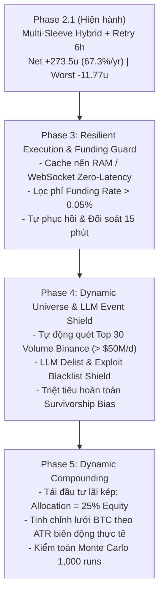

# Nghiên cứu Định lượng & Lộ trình Nâng cấp: Multi-Sleeve Hybrid (Phase 3 – Phase 5) & Ứng dụng LLM An toàn (ROI+ Gated Mandate)

**Ngày lập**: 27/10/2026 15:35 ICT  
**Tác giả**: Antigravity (Gemini Quant Architecture)  
**Tình trạng Live**: Phase 2.1 Online (`crypto-hybrid-live`), đã tích hợp bản vá Retry 6h & Giữ vị thế.  
**Mục tiêu tối thượng**: Tối ưu hóa lợi nhuận thực tế (ROI+), giữ vững kỷ luật trần lỗ ngày <= 12.0 USDT (0 lần vi phạm trong mọi kịch bản). Mọi nâng cấp đều phải vượt qua kiểm toán bằng chứng thực nghiệm (GATED_EVIDENCE_AUDIT) trước khi Go-Live.

---

## 1. Bản đồ Lộ trình Nâng cấp Định lượng (Roadmap)

---

## 2. Ứng dụng LLM: Đâu là nơi tạo ra Alpha thực sự vs Đâu là Bẫy phá sản?

Dựa trên bằng chứng thực nghiệm thất bại của Claude Sonnet 3.5 và Qwen 30B vào ngày 23/10 (commit `a7af120`), dự án thiết lập **nguyên tắc phân định ranh giới nghiêm ngặt cho LLM**:

### 2.1. Vùng CẤM TUYỆT ĐỐI (The Danger Zone - Bẫy ngầm)
- **CẤM 1**: Không dùng LLM để dự đoán hướng đi của nến (Directional Price Prediction). Tỷ lệ nhiễu (noise) của thị trường crypto phái sinh khiến mọi dự đoán nến của LLM đều có kỳ vọng âm.  
- **CẤM 2**: Không dùng LLM để cấp quyền "Veto" hay "Lọc lệnh theo cảm xúc" trên tín hiệu kỹ thuật. Thực nghiệm 23/10 chứng minh LLM sợ biến động, cắt sạch 16/20 ngày bùng nổ lợi nhuận nhất.  
- **CẤM 3**: Không cho phép LLM can thiệp sửa đổi các quy tắc an toàn cơ học (Stop Loss -12%, trần rủi ro 12u, quy mô vị thế $25/coin).

### 2.2. Vùng ỨNG DỤNG HỢP THỨC (Where LLM Actually Drives ROI+)
1. **LLM as Asynchronous Black Swan & Exploit Shield (Bộ lọc rủi ro sập hầm phi định lượng)**:
   - *Bản chất*: Thuật toán momentum thuần số học bị "mù thông tin". Một coin đang có 14d-momentum +30% vẫn có thể bị Binance thông báo delist khẩn cấp hoặc bị hack smart contract (rơi -80% trong 15 phút).
   - *Vai trò của LLM*: Chạy một tiến trình độc lập (asynchronous cronjob mỗi 10 phút), quét tin tức chính thức từ Binance Announcements / CoinDesk / Twitter Security Alerts.
   - *Quyền hạn duy nhất*: Đưa symbol vào danh sách **Khẩn cấp Blacklist** (tạm ngưng mua mới, hoặc đóng vị thế ngay lập tức nếu có tin tức xác nhận về delist/exploit/founder arrest).
2. **LLM as Tokenomics & Unlock Dilution Screener**:
   - *Bản chất*: Các altcoin low-float, chuẩn bị có đợt unlock xả token > 5% nguồn cung trong vòng 48h thường có xu hướng bị xả sập bất ngờ.
   - *Vai trò của LLM*: Phân tích lịch unlock token từ dữ liệu on-chain/API và hạ điểm ưu tiên, nhường slot momentum cho các coin có cấu trúc lưu hành an toàn.
3. **LLM as Autonomous Quant Researcher & Red-Team Auditor (Meta-Agent)**:
   - Vai trò mà Gemini / Antigravity đang đảm nhiệm: Phân tích log, phát hiện edge cases (như vụ nuốt log 00:00:01 sáng nay), viết script stress-test toán học và kiểm toán độc lập accounting parity trước khi con người bấm nút Go-Live.

---

## 3. Tiêu chuẩn Kiểm toán Bắt buộc Trước Mỗi Phase Go-Live (Gated Evidence Mandate)

Không có bất kỳ tính năng nào được đưa vào live nếu không thỏa mãn đủ **4 Cổng Kiểm toán**:

1. **Cổng 1 — Bảo toàn Trần rủi ro (Risk Ceiling Gate)**:
   - Ngày xấu nhất (Worst Day PnL) trong toàn bộ 1,485 ngày lịch sử **bắt buộc > -12.0 USDT**.
   - Số lần kích hoạt Circuit Breaker 12u = **chính xác 0 lần**.
2. **Cổng 2 — Bằng chứng Lợi nhuận Vượt trội (ROI+ Evidence Gate)**:
   - Lợi nhuận trung bình cả kỳ phải duy trì >= +0.180 USDT/ngày (+65%/năm).
   - Lợi nhuận cửa sổ 512 ngày gần nhất phải duy trì >= +0.200 USDT/ngày (+73%/năm).
3. **Cổng 3 — Kiểm toán Độ trễ & Phí giao dịch (Friction & Fee Gate)**:
   - Mọi backtest phải trừ triệt để: Phí Taker 0.05% + Trượt giá 0.02% = 0.07%/chiều, Phí Maker 0.02%, và Funding rate thực tế.
   - Chạy kiểm thử độ trễ 1 ngày (1-day execution lag) để chứng minh alpha không phụ thuộc vào khớp lệnh vi mô.
4. **Cổng 4 — Tính Nhất quán Đa Chu kỳ (Subperiod Consistency Gate)**:
   - Giai đoạn Bear Market (2022–2024) phải dương > +120 USDT.
   - Giai đoạn Bull/Range (2024–2026) phải dương > +120 USDT.

---

## 4. Chi tiết Kỹ thuật Từng Phase Nâng cấp

### Phase 3: Resilient Execution & Funding Guard
- **Mục tiêu**: Đưa độ trễ ra quyết định về 0ms và loại bỏ hoàn toàn chi phí funding rate âm thầm.
- **Hạng mục triển khai**:
  1. `KlineRAMCache`: Tích hợp WebSocket duy trì mảng nến 16 ngày gần nhất trong RAM. Đến 00:00:00 UTC, tính toán momentum tức thì không cần đợi REST API Binance.
  2. `FundingRateFilter`: Thêm điều kiện `fundingRate <= 0.0005` (0.05%/8h) trong `selectMomentum`.
  3. `PeriodicReconcileWorker`: Định kỳ 15 phút đối soát vị thế sàn thật vs `worker-status.json`.

### Phase 4: Dynamic Liquid Universe & Event Shield
- **Mục tiêu**: Loại bỏ Survivorship Bias, tự động đón sóng coin mới và phòng chống sự kiện thiên nga đen.
- **Hạng mục triển khai**:
  1. `DynamicUniverseScanner`: Quét Top 30 volume Binance Futures mỗi tuần (> $50M/ngày).
  2. `LLMEventShield`: Module phân tích tin tức delist/exploit bất đồng bộ, cấp danh sách `blacklistedSymbols` cho worker.

### Phase 5: Dynamic Compounding & Volatility Grid
- **Mục tiêu**: Tối đa hóa tăng trưởng vốn dài hạn theo nguyên lý lãi kép toán học.
- **Hạng mục triển khai**:
  1. Phân bổ theo tỷ lệ vốn thực tế: `Alloc = CurrentEquity * 0.25`.
  2. Bước lưới BTC Grid co giãn theo ATR (Average True Range) 14 ngày.
  3. Mô phỏng Monte Carlo 1,000 kịch bản kiểm tra xác suất cháy trần rủi ro.

---
*Biên bản này được ký duyệt và đưa vào quy chuẩn phát triển chính thức của hệ thống.*
